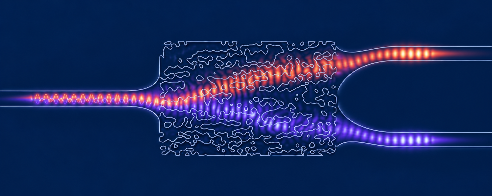
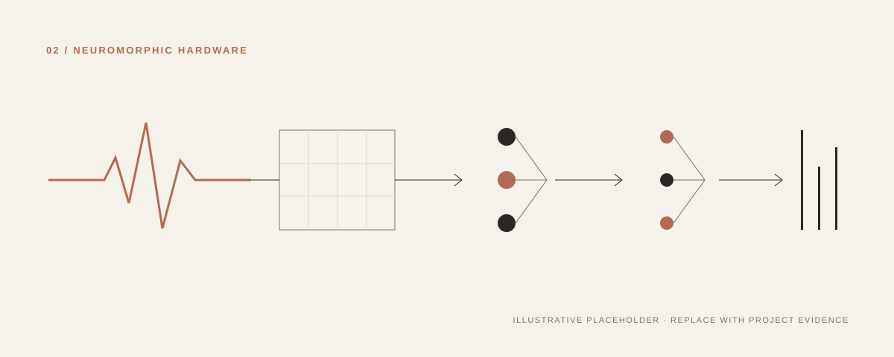
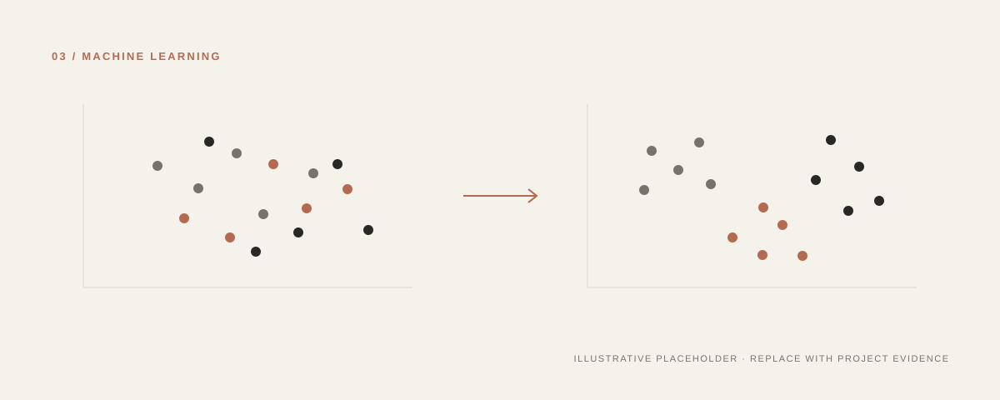
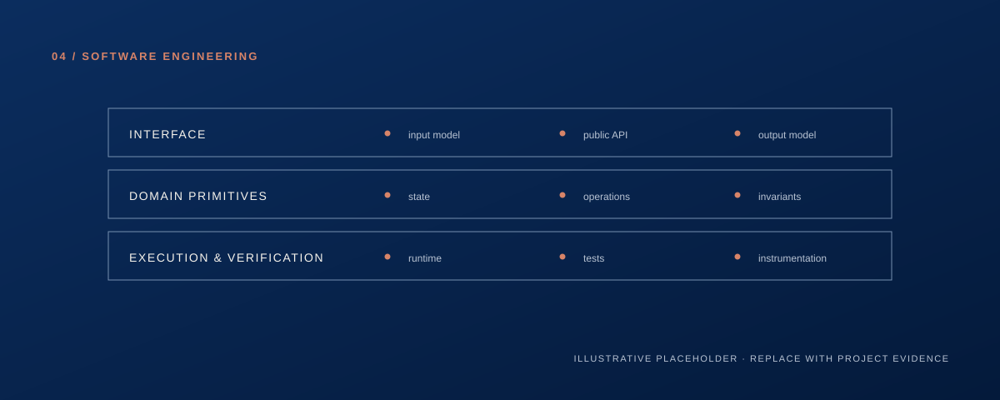

COMPUTER ENGINEERING &nbsp;/&nbsp; RESEARCH

### Engineering intelligent computation from fields to architectures.
AI Accelerators  &nbsp;·&nbsp; AI Software/Hardware Co-Design  &nbsp;·&nbsp; Neuromorphic Systems 

 

01 &nbsp;·&nbsp; PROFILE

---

Hi, I’m Ravan. I’m interested in building more efficient, capable, and reliable machine learning systems.

My work focuses on **computational efficiency**, **hardware-aware machine learning**, and the applications of mathematical models into computing architectures.

 

02 &nbsp;·&nbsp; Selected Works

---

<!--
PROJECT EDITING NOTES

1. Replace each assets/project-XX.svg path with your own image path, or edit the supplied SVG.
2. Replace every [PLACEHOLDER] value with verified project information.
3. Keep descriptions concise: one or two sentences.
4. Do not include benchmark results unless the repository supports them.
5. Recommended image ratio: 16:7 or approximately 1200 × 525 px.
-->

<table>
  <tr>
    <td width="50%" valign="top">
      
        
      01 / COMPUTATIONAL PHOTONICS · [STATUS OR YEAR]
      <h3>[Integrated Photonic AI / Project Title]</h3>
      
[Describe the research question, method, and your technical contribution in one or two concise sentences.]

      
<a href="PROJECT-01-REPOSITORY-URL"><code>VIEW REPOSITORY ↗</code></a>

      [KEYWORD] · [KEYWORD] · [KEYWORD]
    </td>
    <td width="50%" valign="top">
      
        
      02 / NEUROMORPHIC HARDWARE · [STATUS OR YEAR]
      <h3>[Neuromorphic Accelerator / Project Title]</h3>
      
[Describe the architecture, implemented components, and current scope. Separate completed work from planned work.]

      
<a href="PROJECT-02-REPOSITORY-URL"><code>VIEW REPOSITORY ↗</code></a>

      [KEYWORD] · [KEYWORD] · [KEYWORD]
    </td>
  </tr>
  <tr>
    <td width="50%" valign="top">
      
        
      03 / MACHINE LEARNING · [STATUS OR YEAR]
      <h3>[Machine Learning &amp; Vision / Project Title]</h3>
      
[Describe the problem, experimental approach, and what the project demonstrates. Keep metrics in context.]

      
<a href="PROJECT-03-REPOSITORY-URL"><code>VIEW REPOSITORY ↗</code></a>

      [KEYWORD] · [KEYWORD] · [KEYWORD]
    </td>
    <td width="50%" valign="top">
      
        
      04 / SOFTWARE ENGINEERING · 2026
      <h3>Trip Weave</h3>
      
[Tripweave is a website where groups can suggest and vote on activities, build a daily travel plan, and see their route on a map. AI can recommend places, but users decide what gets added.

      
<a href="PROJECT-04-REPOSITORY-URL"><code>VIEW REPOSITORY ↗</code></a>

      FULL-STACK DEVELOPMENT · AI INTEGRATION · TEAM COLLABORATION
    </td>
  </tr>
</table>

 

03 &nbsp;·&nbsp; RESEARCH INTERESTS

---

| PHYSICAL COMPUTATION | INTELLIGENT SYSTEMS | ENGINEERING METHOD |
|:---|:---|:---|
| Integrated photonics Electromagnetic simulation Inverse design | Neuromorphic computing Spiking neural networks Efficient machine learning | AI accelerator architectures Hardware/software co-design Reproducible evaluation |

The common thread is the relationship between **physical hardware**, **computational structure**, and **intelligent behavior**.

 

<!--
Remove this entire section until you have a verified publication, preprint,
technical report, or piece of research writing to include.
-->

04 &nbsp;·&nbsp; PUBLICATIONS & WRITING

---
 

05 &nbsp;·&nbsp; CONTACT

---

[Email]([MAILTO-LINK]) &nbsp;·&nbsp; [GitHub](https://github.com/[USERNAME]) &nbsp;·&nbsp; [LinkedIn]([LINKEDIN-URL]) &nbsp;·&nbsp; [CV]([CV-URL]) &nbsp;·&nbsp; [Website]([WEBSITE-URL])

 

  COMPUTATIONAL PHOTONICS &nbsp;·&nbsp; NEUROMORPHIC SYSTEMS &nbsp;·&nbsp; EFFICIENT AI

